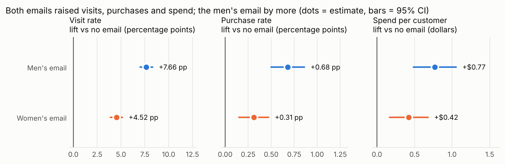
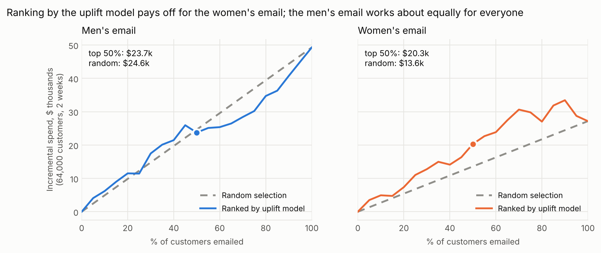
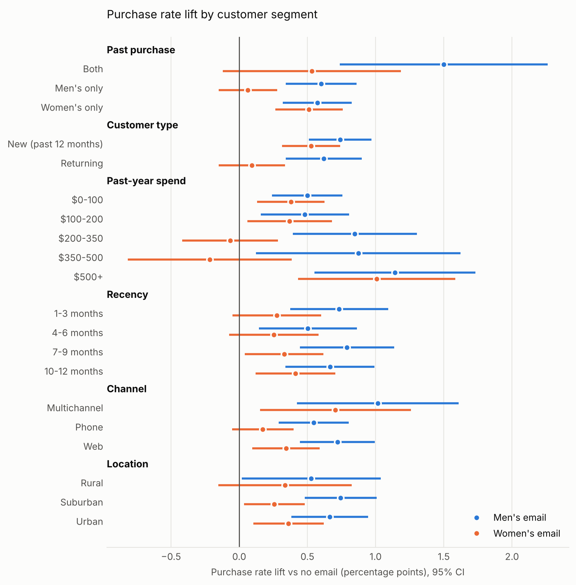
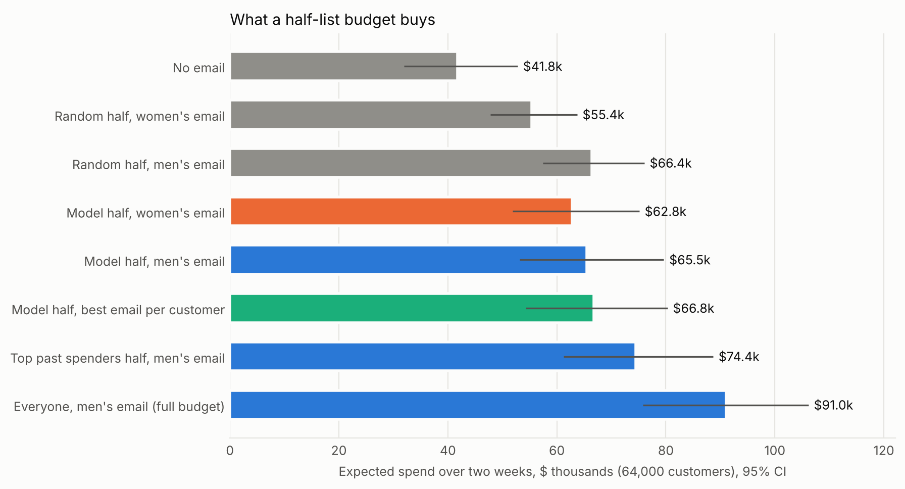

# Email Campaign Lift and Targeting Analysis

A measurement study of a real randomized email experiment. A retailer split **64,000** past
customers at random into three equal groups: one got an email featuring men's merchandise, one
got an email featuring women's merchandise, and one got no email. Customers were then tracked for
two weeks. This project answers five questions:

1. Did each email increase visits, purchases and spend compared with sending nothing, and by how much?
2. Is the difference real or could it be chance?
3. Which email won?
4. Which customer segments responded most, and which did not respond at all?
5. If the retailer could email only half its customers, who should it pick, and how much more
   revenue would that bring than emailing a random half?



## Answers in 90 seconds

| Question | Answer |
|---|---|
| **Did the emails work?** | Yes, both did. Men's email: purchase rate **0.57% → 1.25% (+0.68 pp, +119%)**, spend per customer **+$0.77 (95% CI $0.49–$1.05)**, visit rate +7.7 pp. Women's email: purchases +0.31 pp (+54%), spend +$0.42 (CI $0.17–$0.68). |
| **Real or chance?** | Real. All six email-vs-no-email lifts have Holm-adjusted p ≤ 0.003. The three groups were balanced before the send (largest standardized difference 0.016; sample-ratio test p = 0.90). |
| **Which email won?** | **Men's.** Compared head to head, it had a higher visit rate (+3.1 pp), purchase rate (+0.37 pp, p < 0.001) and spend (+$0.35 per customer, p = 0.03). |
| **Who responded?** | The men's email lifted purchases in **every** segment cut (no segment's interval reaches zero). The women's email showed **no detectable lift** for men's-only buyers, returning customers, $200–$500 past spenders, phone-channel customers or rural customers. Its visit lift among men's-only buyers was +1.1 pp, against +7.4 pp among women's-only buyers (interaction test p < 10⁻²⁰). |
| **Half the list: who to pick?** | **Send the men's email.** A random half brings in about **$24.6k** more spend than sending nothing, over two weeks for the full 64,000-customer list. The uplift model did **not** beat a random half for this email (−$0.9k, CI −$10.3k to +$8.6k), because the email lifts almost everyone equally. For the **women's email**, the model's top half captured **85% of its extra purchases** (+69 purchases vs a random half, CI +14 to +120) and **75% of its extra spend** (+$6.7k vs random, CI −$1.4k to +$15.2k). |

**Recommendation for the marketing team:** send the men's email to the whole list, because every
segment responded and an email costs very little. If the budget covers only half the list, still
send the men's email. Ranking customers by past spend looked best (+$8.0k vs a random half), but
its interval includes zero (−$1.5k to +$16.8k) and it was one of several rankings tried, so test it
against random selection before relying on it. If the women's email has to go out, send it only to
the model's top half.

## How it was built

| Step | What it does | Code |
|---|---|---|
| 0. Load | Downloads the dataset, verifies its SHA-256 checksum, checks 64,000 rows × 12 columns, 0/1 flags, no spend without a purchase, and fixes the raw file's "Surburban" typo | [`email_uplift/data.py`](email_uplift/data.py) |
| 1. Check the experiment | Sample-ratio-mismatch test (were the groups the intended size?), ANOVA and chi-square tests, and standardized differences on every pre-campaign attribute | [`email_uplift/experiment.py`](email_uplift/experiment.py) |
| 2. Measure the lift | Two-proportion z-tests for visit and conversion rates, Welch t-tests for spend, CIs for absolute and relative lift, and a Holm correction across the nine comparisons | [`email_uplift/stats.py`](email_uplift/stats.py), [`experiment.py`](email_uplift/experiment.py) |
| 3. Break it down | SQL in DuckDB aggregates every segment × group cell; Python applies the same tests, Holm-corrected across all 120 segment tests, plus an **interaction test** that checks directly whether the lift differs across segments | [`sql/segment_aggregates.sql`](sql/segment_aggregates.sql), [`email_uplift/segments.py`](email_uplift/segments.py) |
| 4. Targeting model | T-learner uplift model: separate models for each group, scored as P(buy \| email) − P(buy \| no email). Scores are 5-fold **cross-fitted**, so each customer is scored by a model that never saw them. Compared with gradient boosting, visit-based variants and two rules of thumb | [`email_uplift/uplift.py`](email_uplift/uplift.py) |
| 5. Recommendation | Uplift curves (incremental revenue vs % of list emailed), bootstrap CIs, and an inverse-propensity-weighted estimate of what every half-budget plan would earn | [`email_uplift/uplift.py`](email_uplift/uplift.py), [`email_uplift/report.py`](email_uplift/report.py) |
| 6. Present | Generated findings file, charts, a Streamlit dashboard and a five-slide deck, all built from the same result files | [`reports/findings.md`](reports/findings.md), [`app/`](app/streamlit_app.py), [`slides/`](slides/) |

### Key terms

- **Lift**: the outcome in the emailed group minus the outcome in the no-email group. Because the
  groups were assigned at random, this difference is caused by the email.
- **pp (percentage points)**: going from 0.57% to 1.25% is a +0.68 pp absolute lift, or a +119% relative lift.
- **Holm correction**: when you run many tests, some come up "significant" by luck. Holm raises
  each p-value to account for how many tests were run.
- **Uplift model**: predicts how much the email *changes* a customer's chance of buying. A normal
  response model ranks loyal customers who would buy anyway at the top; an uplift model ranks the
  customers the email actually persuades.
- **Uplift curve**: sort customers by predicted uplift, email the top k%, and measure the extra
  revenue in that slice (emailed minus not-emailed). A random ranking gives a straight line.
- **Inverse propensity weighting (IPW)**: each customer had a known 1-in-3 chance of each group.
  To estimate what any targeting plan would have earned, use the customers whose actual group
  matches what the plan would have sent them, weighted by 3.







## Limitations

- **Spend is very noisy.** Only about 1 in 100 customers buys, and order sizes vary widely, so
  dollar estimates have wide intervals. A $0.77 lift has a CI of $0.49–$1.05. Purchase-count
  results are statistically sharper than revenue results.
- **The men's email effect is broad, so targeting it has little room to help.** None of the
  interaction tests for the men's email on purchases or spend found a segment difference. A model
  cannot find variation in the effect that isn't there, and the uplift curve shows this.
- **Model choice and evaluation share the data.** The primary model (logistic T-learner on
  conversion) was fixed before evaluation, and scores are cross-fitted. Still, the comparison
  table includes 6 rankings × 2 emails, so the best one probably looks a little better than it
  would on a new campaign. The "top past spenders" result in particular should be treated as a
  hypothesis to test, not a finding.
- **Bootstrap intervals hold the scores fixed.** They cover evaluation noise but not the
  variation from refitting the model.
- **Two-week window, one campaign, 2008 data.** There is no measure of long-term effects,
  unsubscribes or email fatigue, and email costs are not in the dataset, so "email everyone" is
  judged on revenue alone.
- **Data source.** The original minethatdata.com link is offline. We use the copy distributed by
  the scikit-uplift project and verify it by checksum. The row count (64,000) and the 12 columns
  match the original challenge description.

## Run it

```bash
cd projects/email-campaign-uplift
python3 -m venv .venv && source .venv/bin/activate
pip install -r requirements.txt

python -m email_uplift.data download     # ~0.4 MB download, checksum-verified → data/hillstrom.csv
python -m email_uplift.report            # all tables, charts, findings.md (~1 min)
python slides/build_slides.py            # slides/email-campaign-summary.pptx
streamlit run app/streamlit_app.py       # interactive dashboard
pytest                                   # 21 tests, synthetic data, no download needed
```

The tests use synthetic data with **known** treatment effects. They check that the statistics
match `statsmodels` and `scipy`, that the CIs for zero-inflated spend reach their stated 95%
coverage, that the SQL aggregates equal a pandas `groupby`, that the balance checks catch a broken
split, and that the uplift model finds a planted segment effect while random scores do not.

## Layout

```
email_uplift/
  data.py          download, checksum, validation, segment labels
  stats.py         z-test, Welch t-test, CIs, Holm correction, minimum detectable effect
  experiment.py    randomization checks, overall lift table
  segments.py      SQL segment aggregates → per-segment lift, interaction tests
  uplift.py        T-learner models, cross-fitting, uplift curves, bootstrap, policy evaluation
  charts.py        matplotlib figures
  report.py        runs everything → reports/
sql/segment_aggregates.sql
app/streamlit_app.py
slides/build_slides.py → slides/email-campaign-summary.pptx
reports/findings.md, reports/results/*.csv|json, reports/figures/*.png
tests/
```

## Resume bullets (filled with this project's results)

- Measured the causal impact of two email campaigns on **64,000 customers** in a randomized
  experiment. The winning (men's) email raised the conversion rate by **119% (0.57% → 1.25%)** and
  added **$0.77 of spend per customer** (Holm-adjusted p < 0.001), after balance and sample-ratio
  checks confirmed the split was fair.
- Built a cross-fitted **uplift model** (T-learner, scikit-learn) to rank customers by expected
  response. For the women's email, emailing the **top 50%** captured **85% of its incremental
  purchases** and **75% of its incremental revenue**. For the men's email, the model showed that
  targeting beats random selection by nothing, so the recommendation was to email everyone.
- Ran segment analysis in **SQL (DuckDB)** with multiple-comparison control and interaction tests,
  which showed the women's email had no detectable effect on men's-only buyers or returning customers.
