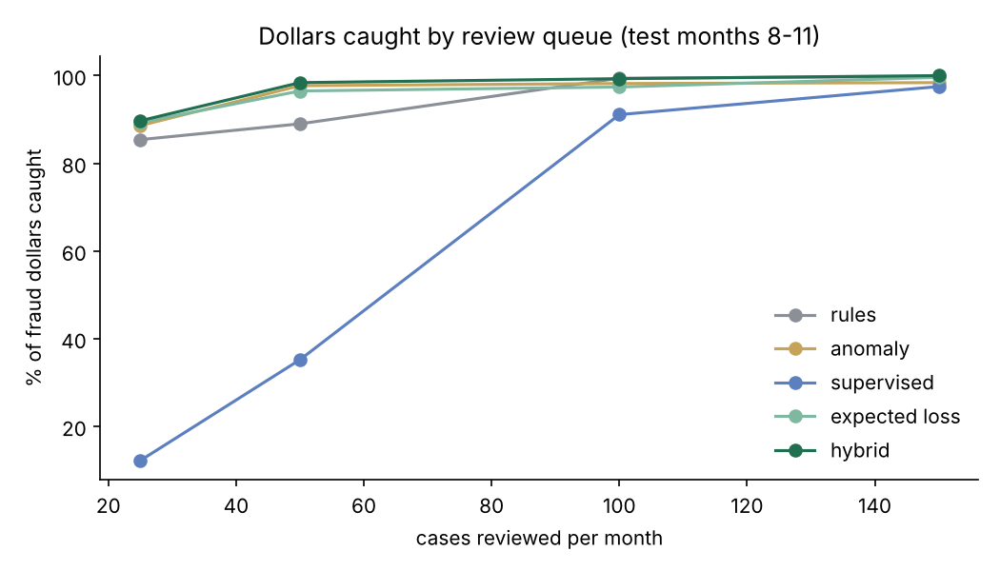
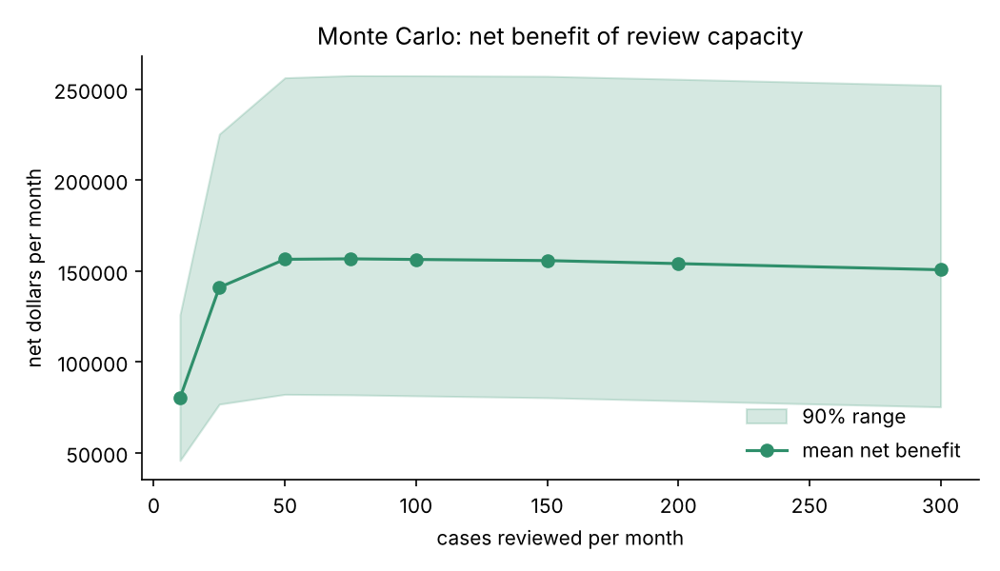

# Parcel Fraud & Revenue-Protection Controls Lab

A runnable lab that answers one question a fraud-controls team faces every month:
**analysts can review only so many cases. Which ones should they open, and how many
reviewers is enough?**

It combines the techniques a data and text mining analyst uses on that problem:
business-control rules, text mining of claim narratives, network analysis of linked
accounts, anomaly detection, a supervised model, and Monte Carlo simulation for capacity
planning. Everything runs in about 30 seconds.

> **The data is synthetic.** It is generated with a fixed seed and contains three planted
> fraud schemes, so every method can be scored against a known answer. No real company or
> customer data is used. On real data, the model numbers would be lower; the method,
> the comparisons and the trade-offs are the point.

## The three planted schemes

| Scheme | What happens | What it costs |
|---|---|---|
| **Theft of service (account takeover)** | A real customer's account suddenly ships from a new device to new addresses, mostly express, often to "mule" addresses that receive from many accounts | Charges billed to the victim |
| **Weight under-declaration** | A shipper declares 45-70% of the weight the hub scale measures | Unbilled revenue |
| **Claims-fraud ring** | 4 rings of linked accounts share devices and recipient addresses and file "not received" claims with near-identical stories | Claim payouts |

Plus ordinary noise that trips naive rules: a November-December volume peak, honest new
devices, honest weighing errors and about 6,700 genuine claims written in varied language.

**Scale:** 3,000 accounts, 12 months, 460,978 shipments, 7,288 claims; 984 account-months
with planted fraud.

## How it works

```
generate.py   seeded data: accounts, shipments, claims, and the answer key
features.py   account-month signals, using only data available at the end of that month
                behavioural: volume vs own trailing median, new devices, new destinations,
                             declared vs measured weight, express mix, mule-address share
                text mining: TF-IDF on claim narratives, near-duplicate stories filed by
                             OTHER accounts in the same or earlier months, urgency terms
                network:     union-find over shared devices and recipient addresses
detect.py     five review queues, trained on months 1-7 and tested on months 8-11
simulate.py   Monte Carlo: 2,000 bootstrap runs x fraud-volume uncertainty x capacity
run.py        runs everything and writes outputs/ (metrics.json, CSVs, charts)
```

## Results (test months 8-11: 444 fraud cases, $618,152 at risk)

Analysts review the top 50 account-months each month:

| Review queue | Precision | Cases caught | Fraud dollars caught | Takeovers caught |
|---|---|---|---|---|
| Rules only (6 business controls) | 86.5% | 39.0% | 89.0% | 95% |
| Anomaly detection (Isolation Forest) | 65.5% | 29.5% | 97.7% | 95% |
| Supervised model (gradient boosting) | 100% | 45.0% | 35.2% | 50% |
| Expected loss (model x dollars exposed) | 100% | 45.0% | 96.5% | 70% |
| **Hybrid (theft rules escalate, expected loss ranks the rest)** | **97.0%** | **43.7%** | **98.4%** | **95%** |



## What I found

1. **The best classifier is not the best queue.** The supervised model ranks cases best
   (PR-AUC 0.98 vs 0.85 for rules), but at 50 reviews a month it catches only 35% of the
   dollars: it fills the queue with many small under-declaration cases. Ranking by
   *expected loss* (probability x dollars exposed) lifts that to 96.5%.
2. **Rules still matter for rare, severe fraud.** The model saw only about 35 takeovers in
   training and catches half of them. Three high-precision theft controls (volume spike,
   device shared across accounts, mule address) catch 95%. Letting those escalate first,
   with the model ranking the rest, gives the best result on every measure that matters.
3. **Fifty reviews a month is enough.** The capacity simulation puts mean net benefit at
   about $156,000 a month at 50 reviews; going to 100 or 300 adds review cost and almost no
   recovered dollars.

   
4. **Text mining finds the rings.** 653 claims have 5 or more near-identical stories filed by
   other accounts; those flags cover 73% of fraudulent claims. Scripted:
   *"never received my camera package high value refund full declared amount asap"*.
   Genuine: *"label was smudged and the parcel went to the apartment lobby instead. we can
   provide the original receipt. order 179932"*.
5. **Each control earns its place, or not.** `outputs/rule_report.csv` shows how often each
   rule fires and how often it is right. Example: the "new device and new destinations" rule
   fires 75 times at 27% precision, so on its own it would waste analyst time.

A bootstrap over accounts (1,000 resamples) puts the supervised model's recall advantage
over rules at 50 reviews a month at +6 points (95% interval +3.6 to +8.8).

## Run it

```bash
python3 -m venv .venv && .venv/bin/pip install numpy pandas scikit-learn matplotlib pytest
.venv/bin/python run.py          # full run, writes outputs/
.venv/bin/python -m pytest -q    # 8 tests: determinism, no answer-key leakage, time split, rules
```

## Honest limits

- Synthetic data makes the planted patterns cleaner than real fraud, so the model scores
  are optimistic. On real data I would expect lower precision and a larger role for
  analyst feedback.
- Fraudsters adapt. A real deployment would retrain on confirmed outcomes, watch each
  control's precision month to month, and retire rules that stop paying for their reviews.
- Dollars at risk assume a reviewed case is stopped in full; in practice recovery is partial.
